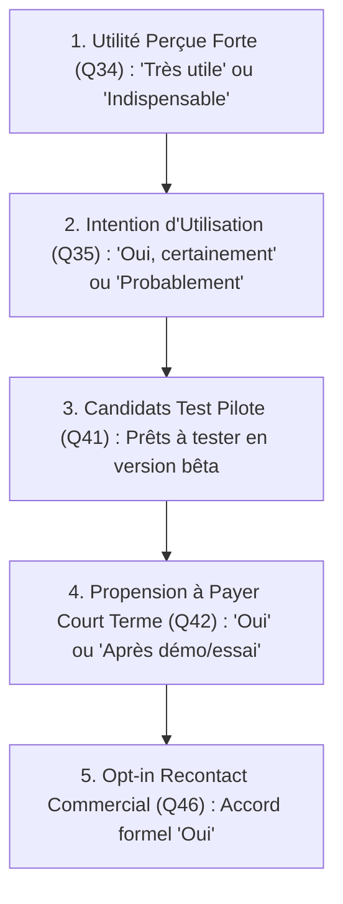

# FORMULES ET RÈGLES DE CALCUL DES INDICATEURS KPI — PROJET SONDAGE
**Version :** 2.2  
**Date :** Octobre 2026  

---

## 1. Principes Généraux de Calcul

1. **Unicité des Répondants** :  
   Chaque ligne validée dans Google Sheets correspond à un `Submission_ID` unique.
   
2. **Dénominateur Global ($N_{valide}$)** :  
   Nombre total de réponses enregistrées dans `Reponses_Sondage_v2` ayant un `Submission_ID` non vide et excluant les lignes d'en-tête ou de test explicitement marquées.
   $$N_{valide} = \sum_{\text{lignes valides}} 1$$

3. **Traitement des Données Manquantes** :  
   Pour les questions optionnelles ou non applicables, les réponses vides (`""` ou `null`) sont exclues du calcul des pourcentages de la question correspondante, ou signalées sous la modalité « Non renseigné ».
   Le dénominateur spécifique d'une question $q$ est :
   $$N_q = \sum_{i \in \text{valides}} \mathbb{I}(\text{réponse}_{i, q} \neq \emptyset)$$

4. **Questions à Choix Multiple (Q12, Q13, Q23, Q25)** :  
   - Les choix sont concaténés avec un point-virgule (`;`).  
   - **Règle de comptage unitaire** : Un répondant ayant sélectionné une option n'est comptabilisé qu'une seule fois pour cette option, quel que soit le formatage.  
   - **Formule de fréquence d'une modalité $m$** :
     $$\text{Fréquence}(m) = \sum_{i=1}^{N_{valide}} \mathbb{I}(m \in \text{réponses}_{i, q})$$
   - **Pourcentage de pénétration** :
     $$\% \text{ Répondants concernés}(m) = \frac{\text{Fréquence}(m)}{N_{valide}} \times 100$$
   - *Note d'interprétation obligatoire :* La somme des pourcentages d'une question à choix multiple dépasse généralement 100 % et reflète le taux de répondants touchés par chaque option.

---

## 2. Définition Détaillée des Indicateurs par Catégorie

### A. Volume et Qualité de la Collecte

| Indicateur | Formule / Définition | Dénominateur | Règle d'exclusion |
|---|---|---|---|
| **Nombre total de réponses** | Nombre de lignes valides dans `Reponses_Sondage_v2` | — | Lignes de test (ex: ID commençant par `test_`) exclues si filtre activé |
| **Date de la dernière réponse** | $\max(\text{Timestamp\_Serveur})$ | — | Formatée en heure locale Cameroun (UTC+1) |
| **Taux de complétion** | Pourcentage de réponses ayant au moins 40 des 46 questions renseignées | $N_{valide}$ | — |
| **Volume par période** | Nombre de réponses reçues par jour calendaire ($\text{AAAA-MM-JJ}$) | — | Regroupement par tranche de 24h |

---

### B. Profil et Segmentation des Commerçants

| Indicateur | Formule / Définition | Interprétation |
|---|---|---|
| **Répartition par Ville (Q1)** | $\frac{N_{\text{ville}}}{N_{valide}} \times 100$ | Identifier les bassins urbains majeurs (Douala, Yaoundé, etc.) |
| **Répartition par Secteur (Q2)** | $\frac{N_{\text{secteur}}}{N_{valide}} \times 100$ | Hiérarchiser les branches commerciales les plus représentées |
| **Maturité du commerce (Q3)** | $\%$ par tranche d'ancienneté | Distinguer les créateurs (< 1 an) des commerces établis (> 3 ans) |
| **Taille de l'équipe (Q4)** | $\%$ par tranche d'effectif | Part des indépendants solo vs équipes avec vendeurs |

---

### C. Fréquence et Gravité des Problèmes

> [!IMPORTANT]
> **Règle méthodologique :** Ne pas confondre la **fréquence** d'une difficulté citée dans le top 3 (Q13) et la **gravité/impact direct** mesuré par les questions d'écarts (Q14, Q15, Q16, Q17, Q18, Q22).

#### 1. Fréquence des difficultés (Q13) :
- **Classement décroissant** du nombre de citations parmi les 8 difficultés proposées (max 3 choix par répondant).
- Formule : $\%$ de commerçants citant la difficulté $k = \frac{\text{Citations}(k)}{N_{valide}} \times 100$.

#### 2. Échelle de Gravité et Fréquence des Incidents :
- **Ruptures de stock (Q15)** :
  $$\% \text{ Ruptures Fréquentes} = \frac{N(\text{"Plusieurs fois par semaine"} \lor \text{"Plusieurs fois par mois"})}{N_{Q15}} \times 100$$
- **Flou sur le bénéfice réel (Q16)** :
  $$\% \text{ Difficulté Fréquente Bénéfice} = \frac{N(\text{"Très souvent"} \lor \text{"Souvent"})}{N_{Q16}} \times 100$$
- **Écarts inexpliqués en caisse (Q17)** :
  $$\% \text{ Pertes de Caisse Répétées} = \frac{N(\text{"Très souvent"} \lor \text{"Parfois"})}{N_{Q17}} \times 100$$
- **Oublis de crédit client (Q18)** :
  $$\% \text{ Oubli de Dette Répété} = \frac{N(\text{"Souvent"} \lor \text{"Parfois"})}{N_{Q18 \text{ accordant du crédit}}} \times 100$$
- **Pertes financières avérées (Q22)** :
  $$\% \text{ Pertes Récentes Confirmées} = \frac{N(\text{Q22 = "Oui"})}{N_{Q22}} \times 100$$

#### 3. Score d'Impact Combiné (Transparent et Paramétrable) :
Pour classer les axes prioritaires sans arbitraire opaque :
$$\text{Score de Priorité} = (0.6 \times \% \text{ Citation Q13}) + (0.4 \times \% \text{ Incidents Fréquents})$$
Ce score est indicatif et ses composantes restent visualisables séparément.

---

### D. Attentes et Besoins Fonctionnels

| Indicateur | Formule / Définition | Interprétation |
|---|---|---|
| **Top Fonctionnalités (Q23)** | $\frac{\text{Citations}(f)}{N_{valide}} \times 100$ | Hiérarchisation de la roadmap produit (max 5 choix par répondant) |
| **Widgets Smartphone (Q25)** | $\frac{\text{Citations}(w)}{N_{valide}} \times 100$ | Hiérarchisation des indicateurs du dashboard mobile commerçant |
| **Indispensabilité Mode Hors-ligne (Q27)** | $\frac{N(\text{"Oui, absolument (Mode Hors-ligne indispensable)"})}{N_{Q27}} \times 100$ | Validation de la contrainte technique Offline-First |

---

### E. Potentiel Commercial et Entonnoir de Conversion

L'analyse commerciale s'articule autour d'un **entonnoir de conversion à 5 niveaux** :

1. **Taux d'accord pour test pilote (Lead chaud)** :
   $$\text{Taux Pilote} = \frac{N(\text{Q41 } \in \{\text{Oui gratuitement, Oui abonnement réduit, Oui si démo}\})}{N_{Q41}} \times 100$$

2. **Propension à payer (WTP)** :
   $$\text{Taux Prêt à Payer} = \frac{N(\text{Q42 } \in \{\text{Oui, Peut-être après démo, Peut-être après essai}\})}{N_{Q42}} \times 100$$

3. **Opt-in Recontact formel (Q46)** :
   $$\text{Taux Recontact} = \frac{N(\text{Q46 = "Oui"})}{N_{Q46}} \times 100$$
   > [!NOTE]
   > Conformément aux règles éthiques et RGPD, la seule présence d'un email en Q5 ne constitue pas un accord commercial. Seule la réponse explicite `Oui` à Q46 est comptabilisée.

4. **Fourchette de Prix Acceptable (Q37)** :
   Distribution par tranches de prix en FCFA (Gratuit, 1k-5k, 5k-10k, 10k-15k, 15k-25k, >25k FCFA/mois).

---

## 3. Définition des Segments Commerçants Prometteurs

Un segment est qualifié de **« Haut Potentiel »** lorsqu'il cumule :
1. Une proportion élevée de répondants confrontés à des pertes ou à un flou de gestion (Q13, Q16, Q22).
2. Une utilité perçue forte (Q34 = `Très utile` ou `Indispensable`).
3. Une disposition à tester ou payer (Q41/Q42) et un accord de recontact (Q46).

Le dashboard calcule ces métriques croisées en appliquant dynamiquement les filtres par **Ville** et par **Type de commerce**.

